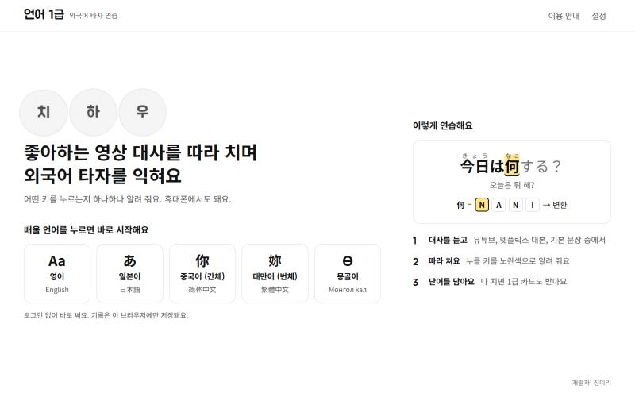
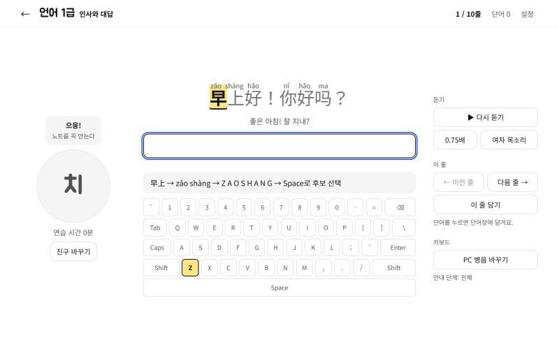
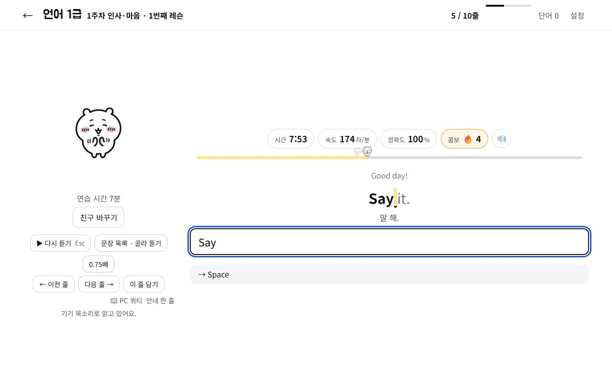
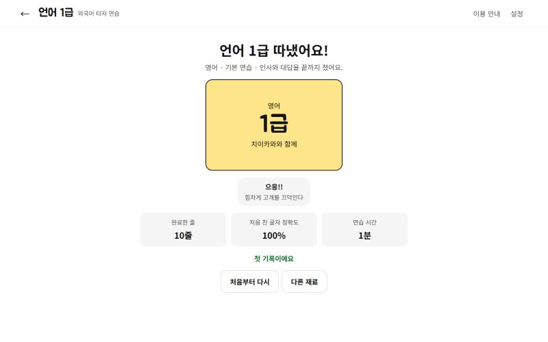
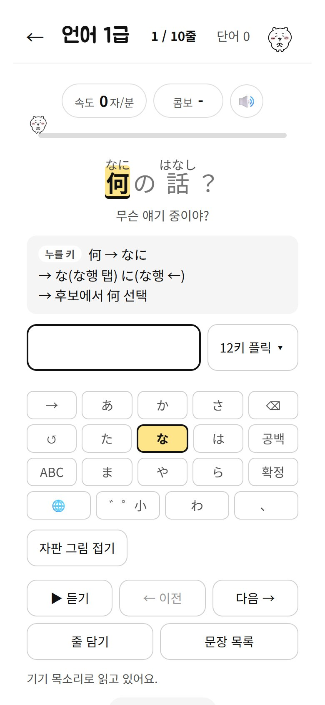
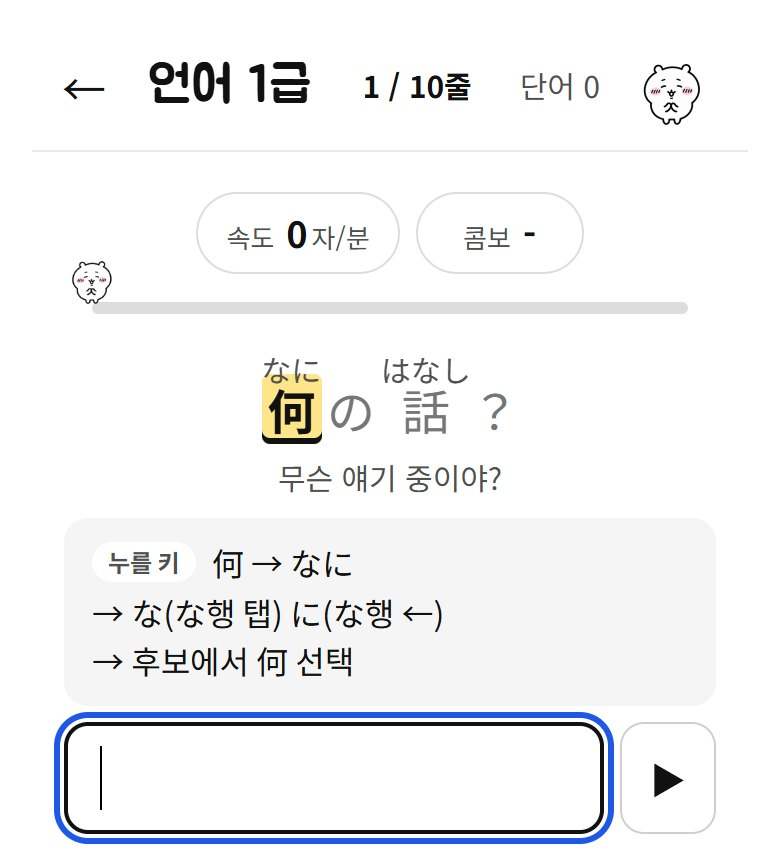
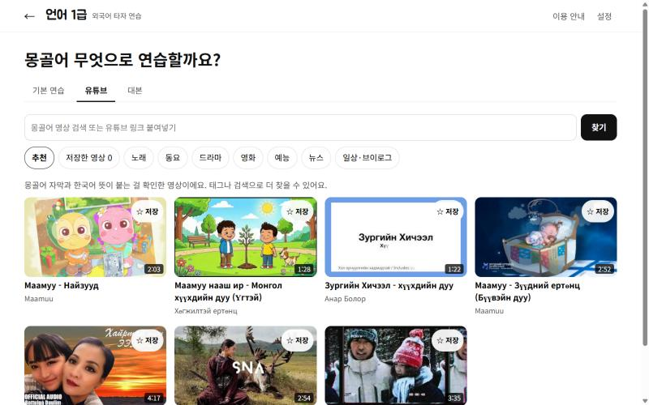
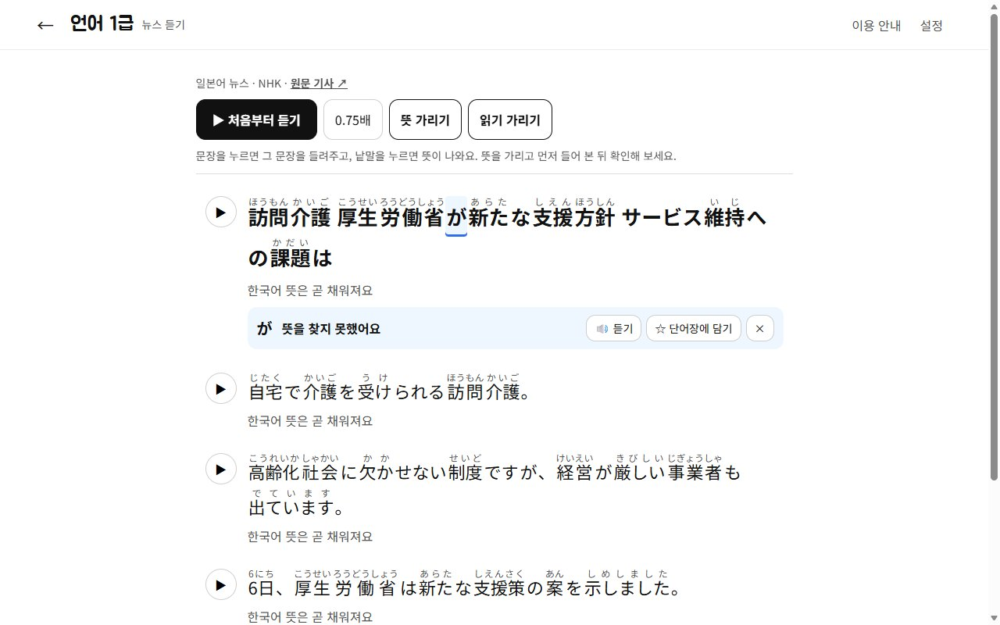
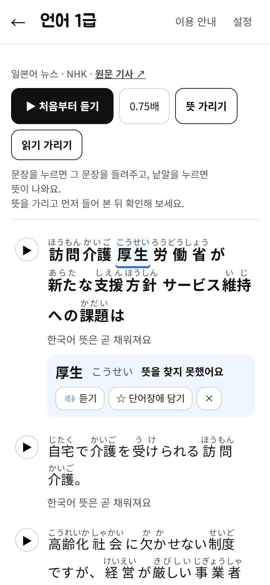

# 언어 1급

좋아하는 노래와 영상 대사를 한 줄씩 따라 치며 외국어 타자를 익히는 사이트입니다. 어떤 키를 누르는지 한 글자씩 알려 주고, 친 단어와 문장을 소리로 들려줍니다. 외국인이 한국어를 배우는 **Learn Korean** 모드도 함께 있습니다.

**사이트:** https://jinmiri-dev.github.io/chiikawa-language-typing/

로그인 없이 바로 쓰고, 기록은 이 브라우저에만 저장됩니다. PC와 휴대폰 모두 됩니다.



## 배울 수 있는 언어

| 언어 | 읽기 표시 | 키 안내 |
|---|---|---|
| 영어 | - | QWERTY (PC·휴대폰) |
| 일본어 | 후리가나 | 로마자 입력(PC·휴대폰), 12키 플릭·탭 |
| 중국어(간체) | 병음 | 병음 입력(PC·휴대폰), 9키는 글 안내 |
| 대만어(번체) | 주음 | 주음(대천)·병음 입력 |
| 몽골어(키릴) | 로마자 전사 | Windows 몽골어 키릴(PC·휴대폰) |

## 초보 6개월 코스

언어 카드를 누르면 **초보 코스**가 먼저 열립니다. 하루 한 레슨(10줄, 약 5분)씩 하면 반 년 과정입니다.

- **0단계 글자 익히기**(5레슨): 일본어 히라가나·가타카나, 중국어·대만어 기초 낱말과 짧은 문장, 영어 자판 줄, 몽골어 키릴 글자.
- **1~24주, 주제별**: 인사·마음 → 사람·가족 → 먹고 마시기 → 시간·하루 → 장소·이동 → 학교·일 → 쇼핑·취미 → 날씨·건강. 이 8개 주제를 **입문(1~8주) → 기초(9~16주) → 초급(17~24주)** 으로 세 번 돌며 문장이 길어집니다. 언어마다 약 1,200줄.
- **자주 쓰는 채팅 표현**: 친구와 채팅할 때 바로 쓰는 짧은 말 4세트.
- **오늘 할 일**: 다음 레슨, 연속 학습일, 전체 진도, 오늘의 복습, 단어 복습. 레슨을 다 치면 바로 다음 레슨으로 이어집니다.
- 주차 문장은 [Tatoeba](https://tatoeba.org)(CC BY 2.0 FR)에서 사람이 한국어로 옮긴 문장을 골랐고, 욕설·폭력·성·민감한 문장은 걸러 냈습니다. 몽골어는 한국어로 옮긴 문장이 적어 영어로 이어진 문장의 뜻을 직접 옮겼습니다.

## 치면서 단어 외우기

- **낱말 짝**: 지금 치는 낱말과 한국어 뜻 속 그 낱말이 같은 파란 밑줄로 함께 밝아지고, 아래에 「話 = 이야기 ☆ 담기」처럼 뜻이 나옵니다. 짝은 AI가 줄마다 만들고, 원문에 실제로 있는 낱말만 남깁니다(설정에서 끌 수 있어요).
- **단어 복습**: 담은 낱말을 10개씩 **뜻 고르기(4개 중 하나) → 뜻 보고 직접 치기**로 복습합니다. 맞히면 1·3·7일 뒤, 틀리면 내일 다시 나옵니다.

## 이렇게 연습해요



PC에서는 왼쪽에 영상·조작·친구, 오른쪽에 문장·입력칸·자판을 두어 **스크롤 없이 한 화면**에 다 보입니다(노트북 화면 1000×600에서도).

1. **언어를 누르면 바로 시작:** 초보 코스, 유튜브 영상, 오늘의 뉴스, 내 대본 중에서 고릅니다.
2. **한 줄씩 따라 치기:** 지금 칠 글자와 누를 키를 노란색으로 알려 줍니다. 입력기로 조합하는 동안에도 어디까지 쳤는지 따라가고, 확정한 글자만 채점합니다. 띄어쓰기와 문장부호까지 봅니다(설정에서 쉽게 채점으로 바꿀 수 있어요).
3. **듣기:** 줄을 다 치면 그 줄을 한 번 더 읽어 주고 그 자리에서 기다립니다. **Enter**로 다음 줄, **Esc**로 다시 듣기, 0.75배는 눌러서 켜고 끄기.
4. **영상과 함께:** 유튜브 재료는 지금 줄 구간만 재생하고 멈췄다가, 다 치면 다시 들려줍니다. 노래는 흐름이 끊기지 않게 Enter 없이 다음 소절로 넘어가요. 진행 막대를 끌면 그 줄로 따라갑니다.
5. **복습과 1급 카드:** 틀린 줄과 담은 단어는 1·3·7일 뒤 복습에 나옵니다. 끝까지 치면 함께한 친구(먼작귀)와 1급 카드를 받습니다.

### 게임처럼 재미있게



- **계기판:** 치는 동안 시간, 속도(1분에 치는 글자 수), 첫 시도 정확도, 콤보(틀리지 않고 이어 친 줄)가 보입니다.
- **지난 나와 경주:** 같은 재료를 다시 치면, 가장 빨랐던 지난 기록이 흐린 친구로 진행 막대 위를 함께 달립니다. 앞서는지 뒤처지는지 바로 알 수 있어요.
- **최고 기록:** 완료 화면에서 평균 속도를 보여 주고, 재료나 언어의 최고 기록을 넘으면 「영어 최고 기록 갱신!」으로 축하합니다.
- **효과음:** 맞게 친 글자는 "톡", 틀리면 "둥", 줄을 끝내면 "딩동"이 납니다. 계기판의 🔊나 설정에서 끌 수 있어요.
- **문장 골라 듣기:** 「문장 목록」을 열면 전체 문장이 나오고, 듣고 싶은 문장을 누르면 그 문장만 다시 읽어 줍니다(유튜브는 그 구간을 재생). 「이 줄 치기」로 바로 그 줄로 갈 수 있어요. 뉴스를 들으며 공부할 때 좋습니다.
- **자판 그림:** 중국어·일본어·대만어·몽골어 자판에는 PC 키보드의 영문 글자가 작게 함께 적혀 있어 어느 키인지 찾기 쉽습니다.



### 휴대폰에서

<p>
  
  
</p>

- 폰 브라우저에서 사이트 주소를 열면 됩니다. 브라우저 메뉴의 「홈 화면에 추가」를 누르면 앱처럼 아이콘으로 열 수 있어요.
- 입력칸을 눌러 폰 키보드가 올라오면 자판 그림은 숨기고, **문장 → 뜻 → 누를 키 → 입력칸**만 키보드 바로 위에 남깁니다. 「누를 키」는 플릭·9키·주음 등 쓰는 자판에 맞춰 알려 줘요(예: `に → な행 ←`).
- 키보드를 내리면 자판 그림과 조작 버튼이 다시 보여요. 키보드가 올라와 있을 때는 입력칸 옆 ▶로 다시 들을 수 있어요.
- 기록은 기기마다 따로 저장됩니다. PC에서 하던 걸 이어 하려면 설정에서 백업 파일을 받아 폰에서 올리세요.

### 키보드는 알아서 맞춰져요

치기 시작하면 입력기가 보내는 글자를 보고 실제로 쓰는 자판을 알아봅니다.

- 대만어: 주음 기호가 오면 주음, 로마자가 오면 병음 안내로 바뀝니다.
- 일본어 휴대폰: 로마자면 로마자, 가나가 바로 오면 플릭 안내로 바뀝니다.
- 중국어 휴대폰: 숫자가 오면 9키로 바뀝니다.
- 한글이 쳐지거나, 입력기가 꺼져 있으면 바꾸는 방법을 알려 줍니다.
- **몽골어는 몽골어 자판을 깔지 않아도 됩니다.** PC에서 영문 상태로 자판 그림의 자리대로 누르면 몽골 글자가 들어가요(예: B → м, Shift+D → Б). Shift가 필요한 글자는 Shift와 그 글자 키가 함께 밝아져요.
- 早上처럼 여러 글자 단어에서 앞 글자를 먼저 확정해도 남은 글자의 병음부터 이어서 안내합니다.

## 유튜브 영상



유튜브 탭을 열면 **실제로 열리는 걸 확인한 추천 영상**이 종류별로 먼저 보입니다. 카드에 `가사 · 한국어 뜻` 또는 `자막 · 한국어 뜻`이 붙어 있어 무엇으로 연습하는지 알 수 있습니다. 태그·검색·링크 붙여넣기로 다른 영상도 열 수 있습니다.

원문 줄은 이렇게 구합니다(모두 무료).

| 영상 | 원문 | 한국어 뜻 |
|---|---|---|
| 노래 | 공개 가사 저장소 [LRCLIB](https://lrclib.net)의 시간 가사. 노래 이름·가수·길이가 영상과 맞을 때만 씁니다. 중국어 가사는 간체·번체를 배울 말에 맞춰 바꿉니다. | AI 번역(Cloudflare Workers AI) |
| 자막이 있는 영상 | 영상 자막(자막 서비스) | 한국어 자막, 없으면 AI 번역 |
| 그 밖의 영상 | 유튜브 **스크립트 표시**를 복사해 대본 탭에 붙여 넣기. 시간(0:04)도 같이 붙으면 영상과 줄이 맞춰집니다. | 한국어 스크립트를 함께 붙이면 시간으로 짝지어 줍니다 |

처음 여는 노래는 가사를 찾고 뜻을 번역하느라 30초쯤 걸리고, 한 번 준비한 영상은 다음부터 바로 열립니다. 뮤직비디오와 가사 시간이 조금 어긋나면 연습 화면의 **가사 시간**에서 0.5초씩 맞출 수 있습니다.

## 오늘의 뉴스 · 읽을거리 · 듣기



뉴스는 타자가 아니라 **듣고 읽는 화면**입니다. 분야(국제·사회·경제·과학·IT·건강·스포츠·문화·연예)를 골라 그날 기사를 엽니다.

- **▶ 처음부터 듣기**로 기사 전체를 문장마다 이어서 듣고, 듣고 있는 문장이 노랗게 표시됩니다. 문장 옆 ▶를 누르면 그 문장만 다시 들려줍니다.
- **낱말을 누르면 뜻**이 나오고, 🔊로 그 낱말만 듣거나 ☆로 단어장에 담아 단어 복습에 쓸 수 있어요.
- **뜻 가리기**로 한국어 뜻을 가리고 먼저 들어 본 뒤 확인하고, **읽기 가리기**로 후리가나·병음 없이 읽어 볼 수 있어요. 0.75배로 천천히 들을 수도 있어요.
- 기사마다 언론사가 RSS로 내준 제목과 요약 문장(최대 6문장)을 씁니다. 제목만 있는 기사는 빼고, 기사 전문은 원문 링크로 읽어요.
- **오늘의 읽을거리:** 뉴스보다 긴 글(6~13문장)을 매일 3~7편 받아 같은 방식으로 듣고 읽습니다. 위키백과(CC BY-SA 4.0)의 「오늘의 알찬 글」과, 차·서울·고비 사막·나담·설날처럼 초보에게 알맞은 주제 70개에서 날마다 바뀌는 글이에요. 아이에게 맞지 않는 글이 섞일 수 있는 「많이 본 글」은 쓰지 않아요.
- 한국어 뜻은 중계 서버 AI가 붙이고, 하루 한도가 찼을 때는 크롬·엣지에 들어 있는 번역기(기기 안에서 무료로 번역)로 채웁니다.



| 언어 | 가져오는 곳 |
|---|---|
| 일본어 | NHK 뉴스(분야별 RSS) |
| 영어 | BBC News(분야별), The Guardian |
| 중국어(간체) | BBC 중문, UN 뉴스 |
| 대만어(번체) | 중앙사(분야별 RSS) |
| 몽골어 | iKon.mn |

중계 서버가 매일 09:30·19:00(한국 시각)에 자동으로 받아 두고, 뜻이 빠진 문장은 한 시간마다 다시 채워 봅니다.

## 내 대본

넷플릭스 이중 자막 표, SRT·VTT·CSV·PDF·TXT, 유튜브 스크립트를 붙여 넣거나 올리면 원문과 뜻을 알아서 나눕니다. 소리 표시(`[Music]`, `(ため息)`)와 화자 이름은 빼고, 두 사람 대사는 나눠 줍니다. 나눈 결과는 연습 전에 고칠 수 있고, 링크나 파일로 공유할 수 있습니다.

## 자격증 공부

유튜브 탭의 **자격증** 태그에서 시험과 급수를 고르면 그 급수 단어·문장 영상을 찾아 줍니다.

- 중국어: HSK 1~6급 · 대만어: TOCFL A1~C2 · 일본어: JLPT N5~N1 · 영어: 토익 LC/RC, 오픽 IM/IH/AL

## Learn Korean (외국인 한국어 배우기)

시작 화면의 **Learn Korean**에서 모국어(영어·일본어·간체·번체·몽골어)를 고르면 화면 글과 뜻이 모두 그 말로 나옵니다.

- 한국 동요와, 말이 또렷한 한국 노래를 상황 태그(인사·가족·몸과 병원·계절·마음 등)로 골라 봅니다.
- 가사를 통째로 보며 한국어 · 로마자 발음 · 모국어 뜻을 줄마다 봅니다. 지금 부르는 줄이 따라 밝아집니다.
- 낱말을 누르면 읽어 주고 단어장에 담습니다(조사는 떼고).
- **따라 읽기:** 문장마다 1·2·3번씩 듣고 따라 읽을 틈을 줍니다. 마이크는 쓰지 않습니다.
- **한 줄씩**(한 줄 3번 반복), **따라 부르기**(빈칸 채우기), 빠르기 0.5~1.25배.
- 별을 누른 문장은 **따라쓰기 학습지**가 됩니다. 원고지 칸에 진한 줄 → 연한 줄(따라 쓰기) → 빈 줄 순서이고, 학습자 모국어 뜻이 크게 붙어 인쇄할 수 있습니다.

## 설정

- 키보드: 기기(자동/PC/휴대폰), 언어별 자판, 안내 줄이기
- 보기: 한국어 뜻, 발음(읽기), 원문(끄면 받아쓰기), 쉽게 채점
- 듣기: 다 치면 한 번 더 듣기, 다 들으면 다음 줄로, 목소리(여자/남자), 빠르기, 효과음
- 기록: 백업 파일 받기·올리기(초보 코스 진도·연속 일수, 단어 복습 진도, 최고 기록까지 함께 옮겨요)
- 캐릭터 움직임 줄이기(기기의 동작 줄이기 설정도 따릅니다)

목소리는 기기에 있는 목소리를 씁니다. 크롬에 몽골어 목소리가 없으면 PC의 Microsoft Edge로 열면 몽골어로 들을 수 있습니다.

## 구조

- 화면: Vite + React + TypeScript, GitHub Pages(해시 라우팅)
- 저장: IndexedDB(브라우저 안). 서버에 개인 기록을 두지 않습니다.
- 읽기: 일본어 kuromoji, 중국어·대만어 pinyin-pro(+ 고친 읽기 표), 몽골어 전사, 한국어 로마자(국어의 로마자 표기법)
- 중계 서버: Cloudflare Worker(`worker/`)
  - 유튜브 검색(YouTube Data API), 자막(SearchAPI), 노래 가사(LRCLIB), 번역·낱말 짝·뉴스 분야(Workers AI), 뉴스(언론사 RSS), 넷플릭스 추천(TMDB)
  - 매일 예약 실행으로 뉴스를 미리 받아 둡니다.
  - 한 번 받은 자막·가사는 저장해 두고 다시 부르지 않습니다.
  - 키는 Worker 비밀값에만 두고, 허용한 사이트에서만 부를 수 있으며, 하루·한 사람 사용량 상한을 겁니다.
- 검사: Vitest 시험, oxlint, CodeQL, 빌드 때 CSP

```bash
npm install
```

```bash
npm run dev
```

```bash
npm test
```

## 문서

- 기획: [docs/기획안.md](docs/기획안.md)
- 와이어프레임: [언어 1급 와이어프레임](https://claude.ai/artifact/GCFCH4CsMJLgiCPTCoxgX3), 그림 [docs/mockups](docs/mockups)
- 프론트 설계: [docs/프론트-설계.md](docs/프론트-설계.md)
- 캐릭터 말투: [docs/캐릭터-말투.md](docs/캐릭터-말투.md)
- 아키텍처·API·ERD: [docs/아키텍처-API-ERD.md](docs/아키텍처-API-ERD.md)
- 보안·오류 점검: [docs/보안-점검.md](docs/보안-점검.md)
- 직접 해야 할 일(키 발급·배포): [docs/직접-해야-할-일.md](docs/직접-해야-할-일.md)

## 알림

개인 공부와 수업용으로 만든 비상업 비공식 팬 사이트입니다. 먼작귀(ちいかわ) 캐릭터의 권리는 원작자(나가노)에게 있으며, 캐릭터 그림은 비상업 개인 학습용으로만 씁니다. 노래 가사와 영상의 권리는 각 권리자에게 있으며, 이 저장소에는 가사 본문을 두지 않습니다(처음 열 때 받아 중계 서버에만 저장).

예문 일부는 Tatoeba(https://tatoeba.org) 기여자들의 문장으로, CC BY 2.0 FR 에 따라 씁니다.

개발자: 진미리
