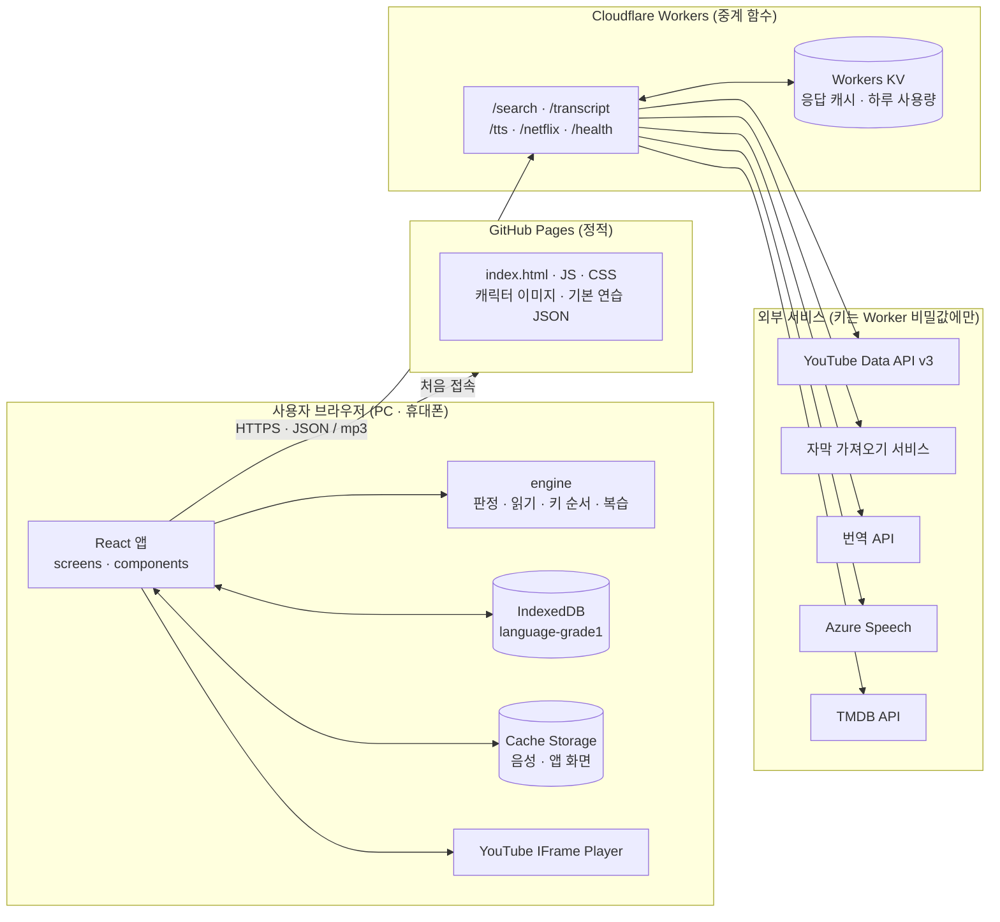
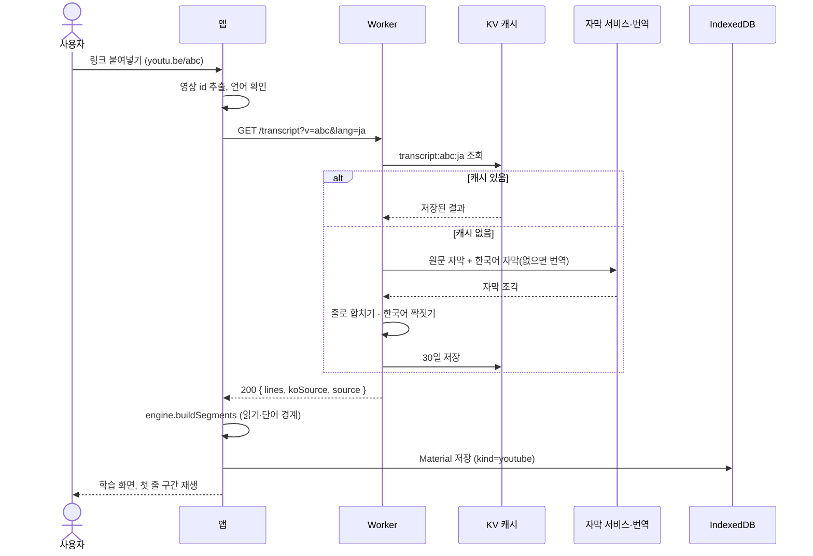
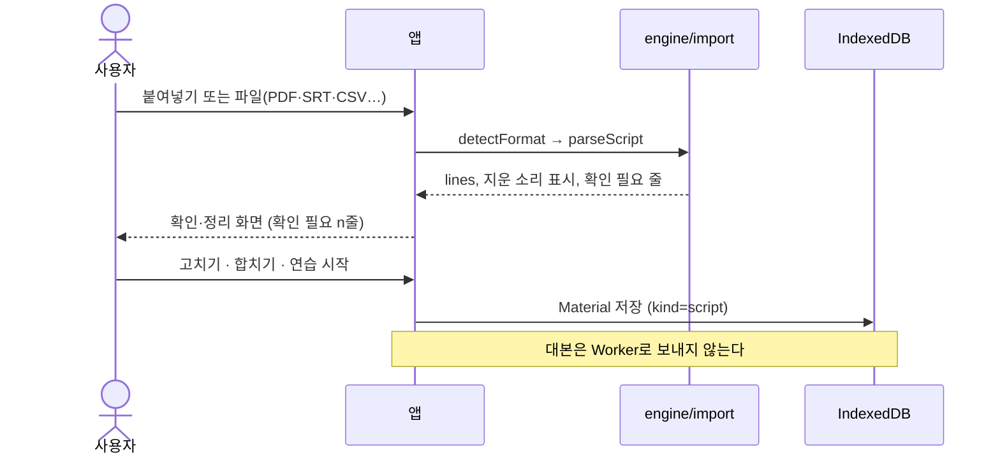
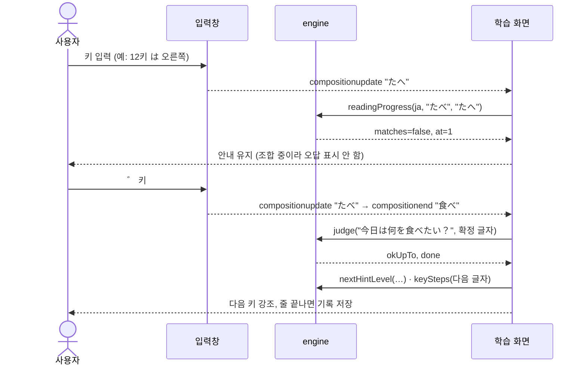
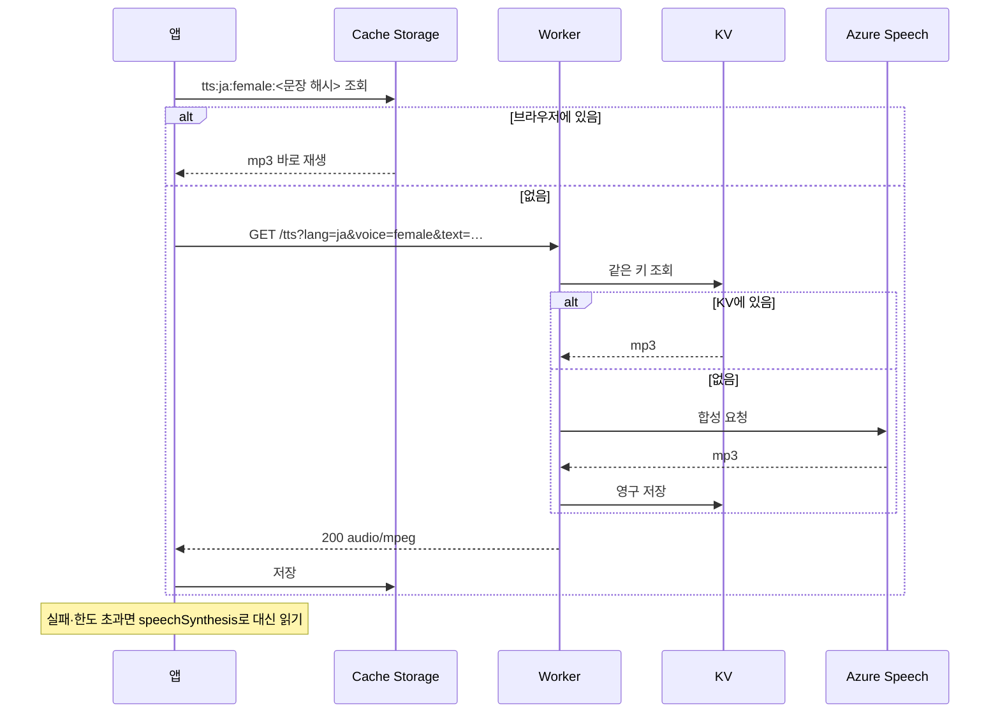
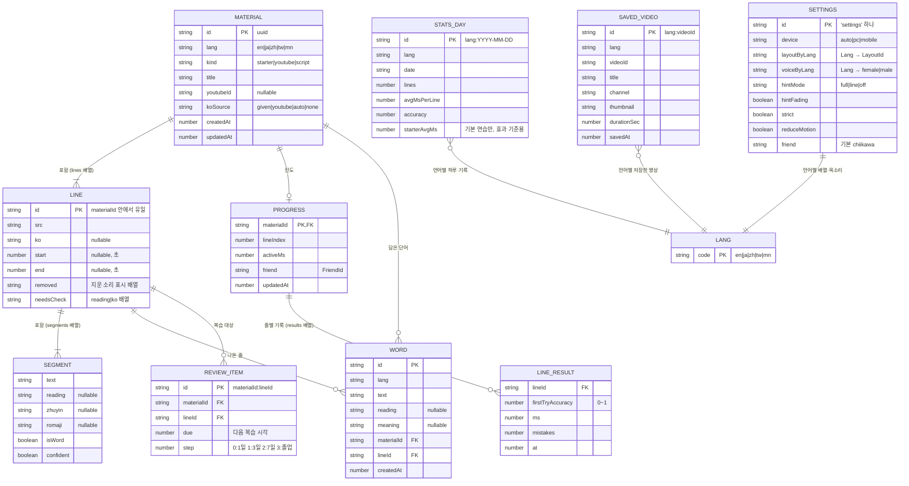
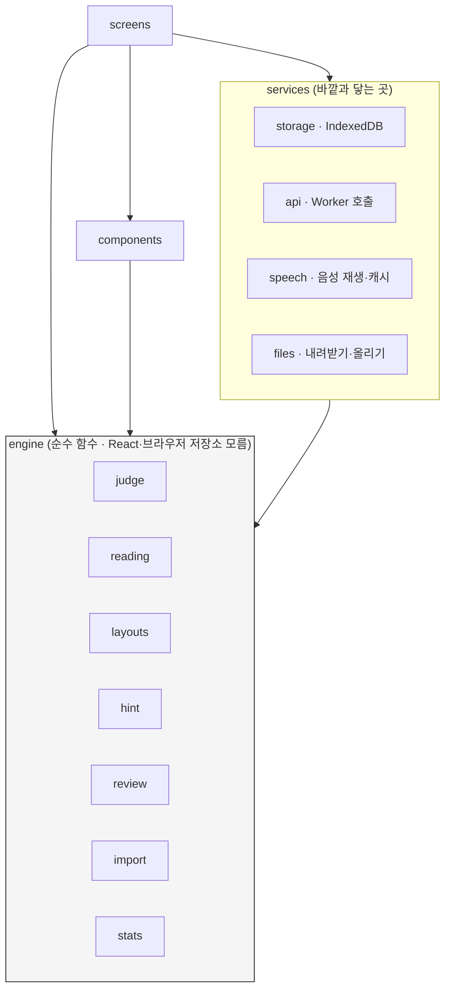
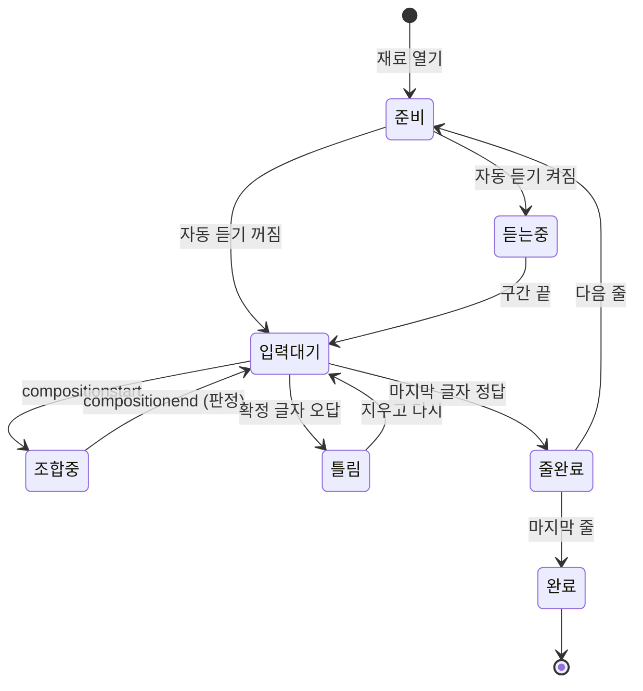

# 언어 1급 — 아키텍처 · API 명세 · ERD

작성일: 2026년 11월 1일
관련 문서: [기획안](기획안.md) · [프론트 설계](프론트-설계.md) · [캐릭터 말투](캐릭터-말투.md)

이 문서는 "무엇이 어디에 있고, 무엇이 무엇과 어떻게 이야기하는가"를 정한다. 코드의 타입 이름과 API 필드 이름은 이 문서와 같아야 한다.

## 1. 시스템 구성



**설계 원칙**
- **서버에 사용자 데이터를 두지 않는다.** 대본, 진도, 단어장은 브라우저 IndexedDB에만 있다. Worker는 공개 정보(영상 자막, 음성, 작품 목록)를 중계하고 캐시할 뿐 사용자를 모른다. 로그인과 사용자 DB가 없는 이유다.
- **키는 Worker에만.** 화면 코드에는 어떤 API 키도 없다.
- **비싼 것은 한 번만.** 같은 영상 자막, 같은 문장 음성, 같은 날 작품 목록은 KV에 저장해 두고 다시 쓴다. 하루 사용량 상한으로 요금을 막는다.
- **Worker가 죽어도 공부는 된다.** 기본 연습과 대본 연습, 저장된 연습은 Worker 없이 동작한다(브라우저 음성으로 대신 읽기).

## 2. 주요 흐름

### 2.1 유튜브 링크로 연습 시작



### 2.2 대본 넣기



### 2.3 한 글자 입력과 판정 (휴대폰 입력기 포함)



### 2.4 듣기 (대본·기본 연습)



## 3. API 명세 (Cloudflare Worker)

### 3.1 공통

| 항목 | 값 |
|---|---|
| 기본 주소 | `https://language-grade1.<계정>.workers.dev` (배포 시 확정) |
| 방식 | 모두 `GET` (캐시하기 쉽고, 사용자 데이터를 보내지 않음) |
| 허용 출처(CORS) | `https://jinmiri-dev.github.io`, `http://localhost:5173` |
| 응답 형식 | JSON (`/tts`만 `audio/mpeg`) |
| 언어 코드 | `en`, `ja`, `zh`(간체), `tw`(번체·대만), `mn` |

**오류 형식** (모든 경로 같음)

```json
{ "error": { "code": "QUOTA_EXCEEDED", "message": "오늘 검색 한도를 다 썼어요.", "retryAfter": 41520 } }
```

| HTTP | code | 언제 | 화면 처리 |
|---|---|---|---|
| 400 | `BAD_REQUEST` | 필수 값 없음, 잘못된 언어 | 개발 오류로 기록 |
| 404 | `NO_TRACK` | 그 언어 자막이 없음 | 상태 안내 "자막 없음" |
| 409 | `EMBED_BLOCKED` | 외부 재생 막힌 영상 | 상태 안내 "재생 막힘" |
| 429 | `QUOTA_EXCEEDED` | 하루 상한 초과 | 상태 안내 "오늘 검색 끝", `retryAfter`(초) 표시 |
| 502 | `UPSTREAM_FAILED` | 외부 서비스 실패 | 다시 시도 버튼, 대본·기본 연습 권유 |

**사용량 헤더**: `X-Quota-Remaining`, `X-Quota-Reset`(UTC 자정까지 초).

### 3.2 `GET /search` — 영상 검색

| 쿼리 | 필수 | 설명 |
|---|---|---|
| `lang` | ✓ | 배울 언어 |
| `q` | | 검색어. 없으면 `tag`의 기본 검색어 |
| `tag` | | `song`, `drama`, `anime`, `variety`, `vlog`, `news`, `kids` |
| `pageToken` | | 다음 쪽 |

```json
{
  "items": [
    { "videoId": "abc123", "title": "…", "channel": "…", "durationSec": 252,
      "thumbnail": "https://i.ytimg.com/vi/abc123/mqdefault.jpg", "embeddable": true }
  ],
  "nextPageToken": "CAoQAA"
}
```
- 자막 있는 영상만(`videoCaption=closedCaption`). 캐시 1시간. 하루 상한: 검색 90회.
- 학습 가능 여부(한국어 자막 있음/자동 번역/불가)는 영상을 고를 때 `/transcript`로 확인한다. 검색 결과마다 확인하면 비용이 커서다.

### 3.3 `GET /transcript` — 자막과 한국어

| 쿼리 | 필수 | 설명 |
|---|---|---|
| `v` | ✓ | 영상 id |
| `lang` | ✓ | 원문 언어 |

```json
{
  "videoId": "abc123",
  "lang": "ja",
  "source": "manual",
  "koSource": "youtube",
  "lines": [
    { "start": 12.3, "end": 15.9, "src": "今日は何を食べたい？", "ko": "오늘은 뭐 먹고 싶어?" }
  ]
}
```
- `source`: `manual`(사람 자막) · `asr`(자동 자막, 줄로 합침).
- `koSource`: `youtube`(영상의 한국어 자막) · `auto`(번역 API) · `none`.
- 캐시 30일(`transcript:{v}:{lang}`). 하루 상한: 새 영상 60개.

### 3.4 `GET /tts` — 음성 합성

| 쿼리 | 필수 | 설명 |
|---|---|---|
| `lang` | ✓ | 언어 |
| `voice` | ✓ | `female` · `male` |
| `text` | ✓ | 한 줄(최대 300자) |
| `rate` | | `1`(기본) · `0.75` |

- 응답: `200 audio/mpeg`, `Cache-Control: public, max-age=31536000, immutable`.
- 캐시 키: `tts:{lang}:{voice}:{rate}:{sha256(text)}` (영구). 하루 상한: 새 합성 2만 자.
- 목소리 이름 표(예: `mn` female = `mn-MN-YesuiNeural`, male = `mn-MN-BataaNeural`)는 Worker 설정에 둔다. 단계 0에서 5개 언어 모두 확정.

### 3.5 `GET /netflix` — 넷플릭스 작품 추천

| 쿼리 | 필수 | 설명 |
|---|---|---|
| `lang` | ✓ | 언어 |
| `type` | | `tv`(기본) · `movie` |

```json
{
  "region": "KR",
  "items": [
    { "tmdbId": 12345, "type": "tv", "title": "…", "originalTitle": "…", "year": 2025,
      "poster": "https://image.tmdb.org/t/p/w185/….jpg", "pick": "일상 대화 많음" }
  ],
  "attribution": "This product uses the TMDB API but is not endorsed or certified by TMDB."
}
```
- TMDB Discover: `with_watch_providers=8`, `watch_region=KR`, `with_original_language`(+ `tw`·`zh`는 `with_origin_country=TW|CN`), 인기순.
- `pick`은 직접 고른 추천 표시(`src/content/netflixPicks.ts`와 같은 표를 Worker도 가짐). 없으면 `null`.
- 캐시 하루. 결과가 0개면 `items: []` (화면이 "작품이 거의 없어요"를 보여 줌).

### 3.6 `GET /health`

`200 { "ok": true, "version": "…" }` — 배포 확인과 상태 표시용. 상한 없음.

## 4. ERD — 브라우저 저장소 (IndexedDB)

로그인과 서버 DB가 없으므로, 이 사이트의 "데이터베이스"는 사용자 브라우저의 IndexedDB 하나다. 아래는 저장소(테이블)와 관계다.



**저장 방식과 인덱스**

| 저장소 | 키 | 인덱스 | 담는 방식 |
|---|---|---|---|
| `materials` | `id` | `lang`, `updatedAt` | `lines`와 그 안의 `segments`를 한 문서에 품는다(같이 읽고 같이 쓰므로) |
| `progress` | `materialId` | `updatedAt` | `results`를 배열로 품는다 |
| `words` | `id` | `lang`, `materialId` | |
| `saved` | `id` | `lang`, `savedAt` | 저장한 영상. 목록을 그릴 때 API를 부르지 않도록 제목·썸네일·길이를 함께 둔다 |
| `review` | `id` | `due` | 시작 화면이 `due <= 오늘`만 읽는다 |
| `stats` | `id` | `lang` | 하루 한 줄, 언어별 |
| `settings` | `id` | | 한 문서 |

- `LANG`은 저장소가 아니라 코드 상수다(관계를 보이려고 그렸다).
- 기본 연습(`kind=starter`)의 원본은 `public/content/starter/<lang>.json`이다. 처음 열 때 `materials`에 복사하고, 원본이 바뀌면 `starterVersion`으로 갱신한다(진도는 줄 id로 유지).
- 스키마 버전: `1`. 바뀌면 `onupgradeneeded`에서 변환한다.

## 5. Worker 캐시 (Workers KV) 키 설계

| 키 | 값 | 수명 |
|---|---|---|
| `search:{lang}:{tag}:{sha1(q)}:{page}` | `/search` 응답 JSON | 1시간 |
| `transcript:{videoId}:{lang}` | `/transcript` 응답 JSON | 30일 |
| `tts:{lang}:{voice}:{rate}:{sha256(text)}` | mp3 바이너리 | 영구 |
| `netflix:{lang}:{type}:{YYYY-MM-DD}` | `/netflix` 응답 JSON | 2일 |
| `quota:{route}:{YYYY-MM-DD}` | 오늘 사용량 숫자 | 2일 |

## 6. 프론트 모듈 의존



규칙: 화살표 반대 방향 import는 금지한다(예: `engine`이 `services`를 부르면 안 된다). 린트 규칙으로 막는다.

## 7. 학습 화면 상태


- `5분 단계`와 `친구 말`은 이 상태와 따로 돈다. 단, 포즈 변경은 `줄완료`에서만 반영한다(입력을 끊지 않기 위해).
- 연습 시간은 `입력대기`·`조합중`·`틀림`에서만 흐르고, 60초 입력 없음이나 탭 숨김이면 멈춘다.
